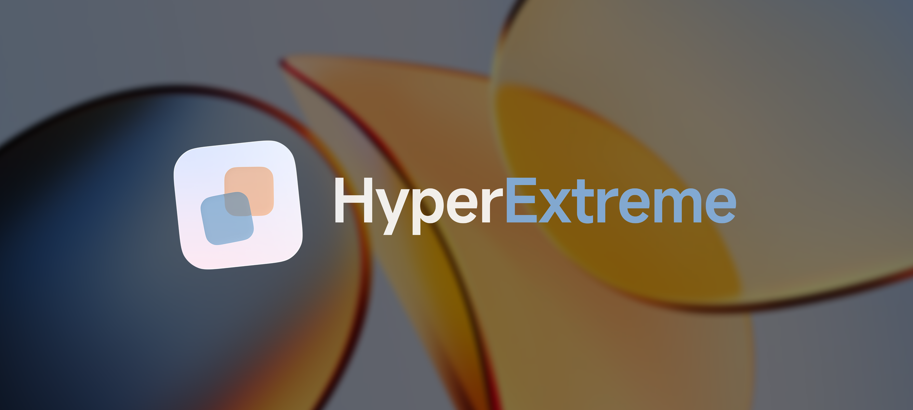

  

  
  
  
  
  

## 介绍

HyperExtreme是一款LSPosed美化模块，支持空间壁纸、光栅壁纸、Alive壁纸等功能，部分功能支持免Root运行。

## 兼容性

对于空间壁纸、光栅壁纸：LSPosed模式只在澎湃OS4上测试，也只会对澎湃OS4适配，**不受理任何澎湃OS4以外系统的使用问题**；系统壁纸服务（免Root）模式理论支持到安卓13，但对安卓17之外的安卓版本未测试。

对于Alive壁纸与其他功能：都需要Root与LSPosed，只会对澎湃OS4适配，**不受理任何澎湃OS4以外系统的使用问题**。

## 使用说明

对于需要LSPosed的功能，请先提前勾选并重启所有推荐作用域（初次安装及模块更新时），再使用对应功能。

本模块可能对修改较多的HyperOS ROM或修改过的推荐作用域应用不生效甚至导致其他问题。

本模块可能与其他修改相同作用域的LSPosed模块产生冲突，在使用模块出现问题时，请先排查模块冲突。

## 开源代码许可

本项目采用AGPL-3.0许可证，有关开源代码许可请在模块的关于页查看。
